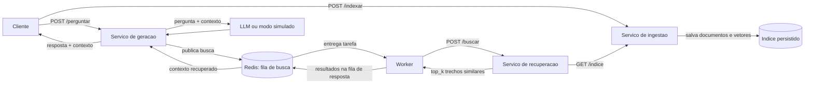

# Kit de Partida — C2.A2: RAG Distribuído em Microsserviços

**Sistemas Distribuídos e Computação em Nuvem · FAESA · 2026/2**
Prof. Howard Cruz Roatti · Lançado na Aula 8 (24/09) · Entrega na Aula 12 (29/10)

---

## O que é isto

RAG (geração aumentada por recuperação) permite que um modelo de linguagem responda
com base em documentos **seus**, sem retreinar nada. Do ponto de vista de sistemas
distribuídos é um caso perfeito: **três responsabilidades distintas** que conversam
entre si, com uma **dependência externa lenta e instável** (a API do LLM) que precisa
ser protegida.

> **Sobre a IA neste trabalho:** todo contato com inteligência artificial aqui é
> **chamada de biblioteca ou de API**. Você **não vai treinar modelos** nem precisar de
> matemática de aprendizado de máquina. O modelo já vem pronto e configurado.
> A sua nota vem da **engenharia distribuída**: arquitetura, comunicação, resiliência e
> execução reproduzível — a sofisticação do modelo **não pontua**.

---

## Como começar

```bash
# 1. Clone o kit e entre na pasta
git clone https://github.com/howardroatti/sd-2026-2-kit-c2a2.git
cd sd-2026-2-kit-c2a2

# 2. Crie e ative o ambiente virtual
python -m venv .venv
# Windows:
.venv\Scripts\activate
# Linux/macOS:
source .venv/bin/activate

# 3. Instale as dependências
pip install -r requirements.txt
```

```bash
# 4. Copie o arquivo de ambiente (funciona offline sem chave de LLM)
cp .env.example .env

# 5. Suba os servicos, Redis e o worker
docker compose up --build -d

# 6. Indexe todos os arquivos .txt de documentos/
python - <<'PY'
import json
from pathlib import Path
from urllib.request import Request, urlopen

documentos = [
    {"texto": arquivo.read_text(encoding="utf-8"), "origem": str(arquivo)}
    for arquivo in sorted(Path("documentos").glob("*.txt"))
]
if not documentos:
    raise SystemExit("Nenhum arquivo .txt encontrado em documentos/")

requisicao = Request(
    "http://localhost:8001/indexar",
    data=json.dumps(documentos, ensure_ascii=False).encode("utf-8"),
    headers={"Content-Type": "application/json"},
    method="POST",
)
with urlopen(requisicao, timeout=30) as resposta:
    print(resposta.read().decode("utf-8"))
PY

# 7. Pergunte; a resposta inclui os trechos usados como contexto
curl -X POST http://localhost:8003/perguntar -H "Content-Type: application/json" \
  -d '{"pergunta":"O que o teorema CAP diz sobre particao de rede?"}'

# Para encerrar os servicos
docker compose down
```

Sem `LLM_API_KEY`, a geracao usa o modo simulado offline. Com uma chave configurada
no ambiente, chama o LLM externo usando somente os trechos recuperados como contexto.

## Arquitetura



O endpoint `/perguntar` espera a resposta correlacionada da fila Redis. Se Redis
estiver indisponivel ou o worker nao responder no prazo, a API retorna `503` em vez
de gerar uma resposta sem os documentos recuperados.

---

## Estrutura do projeto

```
sd-2026-2-kit-c2a2/
├── servicos/
│   ├── comum/
│   │   ├── embeddings.py       # vetorizacao offline
│   │   ├── fila.py             # comunicacao via Redis
│   │   ├── llm.py              # LLM real ou modo simulado
│   │   └── circuit_breaker.py  # protecao da geracao
│   ├── ingestao/app.py         # indice persistente
│   ├── recuperacao/app.py      # busca por similaridade
│   ├── geracao/app.py          # orquestracao de /perguntar
│   └── worker/app.py           # consumidor da fila de busca
├── Dockerfile                  # imagem compartilhada pelos serviços e worker
├── documentos/                 # base de teste para indexar
├── docker-compose.yml          # serviços, Redis e worker
└── TAREFAS.md                  # <- comece por aqui
```

---

## Estado das tarefas

O progresso das tarefas obrigatorias e os itens opcionais estao listados em
**`TAREFAS.md`**.

---

## Como você será avaliado

| Critério | Pontos |
|---|---|
| Arquitetura e decomposição em serviços | 1,5 |
| Comunicação funcionando (REST / gRPC / mensageria) | 1,5 |
| Resiliência e tratamento de falhas | 1,0 |
| Execução reproduzível (README, container, deploy) | 1,0 |
| **Sofisticação do modelo de IA** | **não pontua** |
| **Total** | **5,0** |

**Entrega:** no seu repositório do GitHub, **sem apresentação oral**. Grupos livres.

---

## Aulas de referência

- **Aula 8** — Mensageria, eventos e API Gateway
- **Aula 10** — Replicação, consistência e CAP
- **Aula 11** — Consenso (Raft) e resiliência: circuit breaker
- **Aula 6** — IA como serviço (vocabulário: embedding, inferência, LLM)

---

## Dúvidas frequentes

**Preciso saber machine learning?** Não. O modelo já está pronto e você só chama uma função.

**E se eu não tiver internet no laboratório?** Tudo neste kit funciona offline. O modelo é
treinado localmente e o cliente de LLM tem modo simulado.

**Posso trocar a linguagem?** O kit é em Python porque é o ecossistema usado nas aulas.
Se quiser usar outra linguagem, converse com o professor antes.

**Posso usar IA para me ajudar a programar?** Sim. Este é um trabalho prático feito fora de
sala, e usar ferramentas de IA é realista. O que se avalia é o **sistema funcionando** e as
**decisões de arquitetura** — que você precisa saber explicar.
